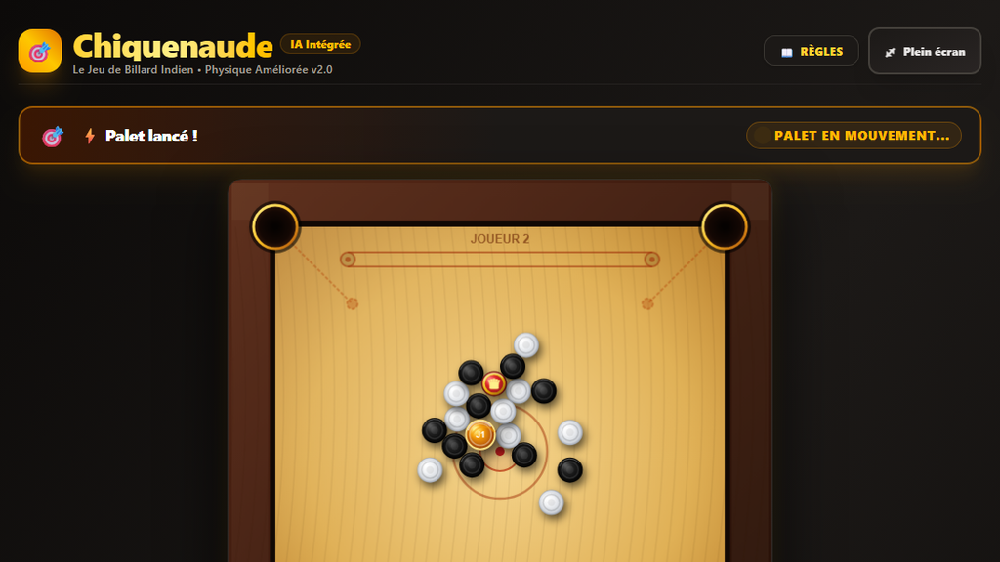

# Chiquenaude

**Le jeu de palets à la pichenette. Visez, tirez, empochez, capturez la reine.**

Joue ici : [games.hylst.fr/chiquenaude/](https://games.hylst.fr/chiquenaude/)



## Comment on joue

Un carrom complet : tirez le striker (le gros palet blanc) d'une pichenette pour empocher
vos propres palets (noirs ou blancs selon votre camp) dans l'un des quatre trous du
plateau. La reine rouge, au centre, vaut un bonus, mais il faut la « confirmer » en
empochant un de vos palets juste après (ou dans le même coup), sinon elle revient au
centre.

Empocher un palet de l'adversaire est une faute : il revient sur le plateau. Empocher le
striker aussi : une de vos pièces déjà validées est remise en jeu.

Le premier joueur à vider tous ses palets, reine confirmée, gagne la manche.

## Contrôles

| Action | Effet |
|--------|-------|
| Glisser-relâcher sur le striker | Vise (distance = puissance) et tire |
| Flèches ← / → | Ajuster l'angle |
| Flèches ↑ / ↓ | Ajuster la puissance |
| Espace / Entrée | Tirer |
| H | Conseil (suggère un coup) |
| F | Plein écran |
| R | Recommencer |

## Ce qu'il y a dedans

- Physique de collision élastique complète (rebonds sur les bords, chocs entre palets)
- Règle de la reine (capture + confirmation), fautes gérées (palet adverse, striker empoché)
- Contre un ami (1 contre 1) ou deux niveaux d'IA
- Bouton Conseil qui calcule un vrai coup jouable
- Combos et statistiques de partie
- Mode plein écran, effets de particules, confettis de victoire
- Musique d'ambiance et effets sonores en Web Audio

## L'arborescence

```
chiquenaude-game-development/
├── index.html          # template + bloc SEO
├── vite.config.ts      # base '/chiquenaude/' + singlefile
├── public/
│   ├── favicon.png
│   ├── og-image.png / og-image.webp
│   └── icon.webp        # carte du menu, 128x128
└── src/
    ├── main.tsx
    ├── App.tsx
    ├── hooks/
    │   ├── useCarromGame.ts   # boucle physique + resolution de tour
    │   └── useFullscreen.ts
    ├── components/
    │   ├── CarromBoard.tsx     # rendu canvas + entrees souris/tactile
    │   ├── ScorePanel.tsx
    │   └── MessageBar.tsx
    └── utils/
        ├── physics.ts          # collisions, murs, empochage
        ├── gameLogic.ts        # etat initial, IA
        ├── particles.ts
        └── audio.ts
```

## Dev

```bash
npm install
npm run dev       # http://localhost:5173/chiquenaude/
npm run build     # dist/index.html, un seul fichier
npm run preview
```

## Stack

React 19, TypeScript 5.9 (strict), Tailwind CSS 4, Vite 7, vite-plugin-singlefile.

Zéro backend, zéro sprite : tout est dessiné en Canvas 2D, les sons sont synthétisés au vol.

## Licence

AGPL-3.0-or-later, Geoffroy Streit (Hylst). Voir `LICENSE`.
